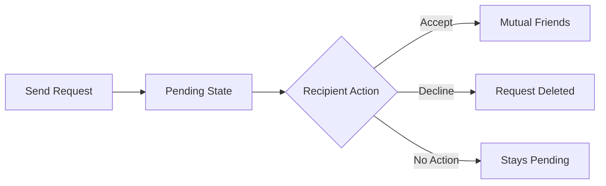

# sTEAtus Feature Specifications

## Table of Contents
1. [Mood Tracking System](#mood-tracking-system)
2. [Social Network Features](#social-network-features)
3. [Real-time Communication](#real-time-communication)
4. [Push Notification System](#push-notification-system)
5. [Data Export & Analytics](#data-export--analytics)
6. [User Interface & Experience](#user-interface--experience)
7. [Authentication & Security](#authentication--security)
8. [Storage & Media](#storage--media)
9. [Settings & Preferences](#settings--preferences)
10. [Accessibility Features](#accessibility-features)

---

## Mood Tracking System

### Core Mood Types
The application supports 8 distinct mood states, each with specific characteristics:

#### 1. **Calm** 😌
- **Description**: Peaceful, relaxed, at ease
- **Color**: Soft blue (#60A5FA)
- **Priority**: Low
- **Notification Trigger**: No
- **Usage Context**: Default positive state

#### 2. **Happy** 😊
- **Description**: Joyful, content, pleased
- **Color**: Soft yellow (#FBBF24)
- **Priority**: Low
- **Notification Trigger**: No
- **Usage Context**: Celebratory moments

#### 3. **Anxious** 😰
- **Description**: Worried, nervous, apprehensive
- **Color**: Soft orange (#FB923C)
- **Priority**: Medium
- **Notification Trigger**: No
- **Usage Context**: Manageable stress

#### 4. **Overwhelmed** 😵
- **Description**: Too much to handle, stressed
- **Color**: Soft red (#F87171)
- **Priority**: High
- **Notification Trigger**: Yes (to support network)
- **Usage Context**: High stress, needs support

#### 5. **Focused** 🎯
- **Description**: Concentrated, in the zone
- **Color**: Soft purple (#A78BFA)
- **Priority**: Low
- **Notification Trigger**: No
- **Usage Context**: Productive periods

#### 6. **Tired** 😴
- **Description**: Exhausted, low energy
- **Color**: Soft gray (#9CA3AF)
- **Priority**: Low
- **Notification Trigger**: No
- **Usage Context**: Need for rest

#### 7. **Shutdown** 🔒
- **Description**: Emotionally withdrawn, need space
- **Color**: Dark red (#DC2626)
- **Priority**: Critical
- **Notification Trigger**: Yes (immediate alert)
- **Usage Context**: Neurodivergent overwhelm state

#### 8. **Meltdown** 🌪️
- **Description**: Emotional overflow, crisis state
- **Color**: Dark red (#B91C1C)
- **Priority**: Critical
- **Notification Trigger**: Yes (immediate alert)
- **Usage Context**: Emergency support needed

### Mood Entry Features

#### Visibility Control
- **Public**: Visible to all friends in support network
- **Private**: Personal tracking only, not shared
- **Default**: Follows user preference setting

#### Acknowledgment System
- Friends can "acknowledge" visible moods
- Acknowledgments are tracked per mood entry
- Acknowledgment count displayed on mood
- Push notifications sent when mood is acknowledged

#### Historical Tracking
- Complete chronological mood history
- Timestamps with timezone support
- Mood duration tracking (time between entries)
- Exportable data in multiple formats

### Mood Analytics

#### Basic Statistics
- Most frequent mood type
- Mood distribution percentages
- Current mood streak information
- Weekly/monthly averages

#### Advanced Insights
- **Positive Ratio**: Percentage of positive moods (calm, happy, focused)
- **Pattern Recognition**: Time-based mood patterns
- **Stress Indicators**: Frequency of overwhelmed/shutdown/meltdown states
- **Tracking Consistency**: User engagement metrics

---

## Social Network Features

### Friend System Architecture

#### Friend Relationship States
1. **Pending**: Friend request sent, awaiting response
2. **Accepted**: Mutual friendship established
3. **Blocked**: User blocked (future feature)

#### Friend Request Flow


### Contact Discovery Methods

#### 1. User Search
- **Search Fields**: Username, display name
- **Search Logic**: Case-insensitive partial matching
- **Results Filtering**: Excludes existing friends and pending requests
- **Pagination**: 10 results per page, expandable to 50

#### 2. Friend Codes
- **Format**: `TEA-{8-character-prefix}`
- **Generation**: First 8 characters of user UUID
- **Usage**: One-time or reusable codes
- **Validation**: Format checking and user existence verification

#### 3. Email Invitations (Future)
- Send email invites to non-users
- Custom invitation messages
- Invitation tracking and reminder system

### Support Network Display

#### Contact Information
- **Profile Picture**: Avatar or emoji fallback
- **Display Name**: Preferred name or username
- **Current Mood**: Latest visible mood with timestamp
- **Online Status**: Real-time presence indicator
- **Last Seen**: Time since last activity

#### Network Activity Feed
- Recent mood changes from friends
- Acknowledgment activities
- Network growth notifications
- Privacy-respecting activity summaries

---

## Real-time Communication

### Socket.io Implementation

#### Connection Management
- **Authentication**: JWT token-based auth
- **Reconnection**: Automatic with exponential backoff
- **Room Management**: User-specific rooms for targeted messaging
- **Heartbeat**: Regular ping/pong for connection health

#### Event Types

##### Client → Server Events
- `mood_update`: User changed their mood
- `acknowledge_mood`: User acknowledged someone's mood
- `join_user_room`: Subscribe to user-specific events
- `presence_update`: User online/offline status change

##### Server → Client Events
- `contact_mood_update`: Friend's mood changed
- `mood_acknowledged`: Someone acknowledged your mood
- `user_online`/`user_offline`: Friend presence changes
- `online_users`: Bulk online status update

### Supabase Realtime Integration

#### Real-time Subscriptions
1. **User Moods**: Own mood changes across devices
2. **Contact Moods**: Friends' mood updates
3. **Friend Requests**: Incoming/outgoing request status
4. **Settings Changes**: Preference sync across sessions
5. **Acknowledgments**: Real-time acknowledgment notifications

#### Conflict Resolution
- Server-authoritative for data consistency
- Client optimistic updates with rollback
- Timestamp-based conflict resolution
- User notification for sync conflicts

---

## Push Notification System

### Web Push API Implementation

#### VAPID Configuration
- **Public Key**: Client-side subscription key
- **Private Key**: Server-side signing key
- **Contact Email**: VAPID identification
- **Key Rotation**: Quarterly security update

#### Subscription Management
- **Browser Support**: Chrome, Firefox, Safari, Edge
- **Subscription Storage**: User-linked push endpoints
- **Permission Flow**: Progressive permission requests
- **Unsubscription**: Clean removal from server

### Notification Types & Triggers

#### 1. Critical Mood Alerts
- **Triggers**: Shutdown, Meltdown, Overwhelmed states
- **Recipients**: All friends in support network
- **Content**: "{User} is feeling {mood} and might need support"
- **Actions**: "View App", "Dismiss"
- **Priority**: High

#### 2. Acknowledgment Notifications
- **Triggers**: When someone acknowledges user's mood
- **Recipients**: Mood entry creator only
- **Content**: "{Friend} acknowledged that you're feeling {mood}"
- **Actions**: "View App", "Dismiss"
- **Priority**: Normal

#### 3. System Notifications
- **Triggers**: App updates, maintenance, security alerts
- **Recipients**: All active users
- **Content**: Contextual system messages
- **Priority**: Normal

### Service Worker Features

#### Notification Handling
- **Click Actions**: Open app, focus existing tab, or navigate to specific page
- **Rich Notifications**: Images, icons, action buttons
- **Notification Queue**: Batch similar notifications
- **Expiration**: Time-limited relevance

#### Offline Support
- **Background Sync**: Queue actions when offline
- **Cache Management**: Static asset caching
- **Data Synchronization**: Conflict-free data merging

---

## Data Export & Analytics

### Export Formats

#### 1. CSV Export
```csv
Date,Time,Mood,Emoji,Description,Visible to Friends,Acknowledgments,ISO Timestamp
2024-01-15,14:30,Happy,😊,Joyful content pleased,Yes,3,2024-01-15T14:30:00.000Z
```

**Fields Included**:
- Date & Time (local timezone)
- Mood type and emoji
- Mood description
- Visibility status
- Acknowledgment count
- ISO timestamp for analysis

#### 2. PDF Report
**Report Sections**:
1. **Executive Summary**: User info, date range, total entries
2. **Mood Distribution**: Visual charts and percentages
3. **Timeline Analysis**: Recent mood history table
4. **Insights**: Automated pattern analysis
5. **Recommendations**: Based on mood patterns

**Visual Elements**:
- Pie charts for mood distribution
- Timeline graphs for mood progression
- Color-coded mood indicators
- Professional formatting for healthcare sharing

### Advanced Analytics

#### Pattern Recognition
- **Time-of-Day Analysis**: When moods typically occur
- **Day-of-Week Patterns**: Weekly mood cycles
- **Seasonal Trends**: Long-term mood variations
- **Trigger Analysis**: External factors correlation

#### Predictive Insights
- **Mood Forecasting**: Based on historical patterns
- **Risk Assessment**: Likelihood of critical mood states
- **Intervention Timing**: Optimal support moments
- **Recovery Patterns**: Time to positive mood return

#### Healthcare Integration
- **FHIR Compatibility**: Healthcare data standard support
- **Provider Sharing**: Secure healthcare professional access
- **Medical History**: Integration with health records
- **Therapy Support**: Mood data for therapy sessions

---

## User Interface & Experience

### Design Philosophy

#### Neurodivergent-Friendly Design
- **Hand-drawn Aesthetic**: Reduces clinical/sterile feeling
- **Soft Color Palette**: Calming, non-aggressive colors
- **Clear Visual Hierarchy**: Predictable layout patterns
- **Reduced Cognitive Load**: Minimal decision-making required

#### Accessibility-First Approach
- **High Contrast**: Dark mode with proper contrast ratios
- **Font Scaling**: Responsive to user preferences
- **Screen Reader Support**: Semantic HTML and ARIA labels
- **Keyboard Navigation**: Full functionality without mouse

### Component Architecture

#### Atomic Design System
1. **Atoms**: Basic elements (buttons, inputs, icons)
2. **Molecules**: Combined atoms (mood selector, user card)
3. **Organisms**: Page sections (navigation, mood timeline)
4. **Templates**: Page layouts
5. **Pages**: Complete user interfaces

#### Design Tokens
```css
:root {
  /* Colors */
  --color-primary: #f59e0b;
  --color-secondary: #ea580c;
  --color-accent: #dc2626;
  
  /* Spacing */
  --space-xs: 0.25rem;
  --space-sm: 0.5rem;
  --space-md: 1rem;
  --space-lg: 2rem;
  --space-xl: 4rem;
  
  /* Typography */
  --font-size-sm: 14px;
  --font-size-md: 16px;
  --font-size-lg: 18px;
  
  /* Borders */
  --border-radius-sm: 8px;
  --border-radius-md: 16px;
  --border-radius-lg: 24px;
}
```

### Animation & Interaction

#### Micro-Interactions
- **Hover States**: Gentle scale and color transitions
- **Loading States**: Skeleton screens and spinners
- **Success Feedback**: Subtle confirmation animations
- **Error States**: Non-threatening error indications

#### Page Transitions
- **Route Changes**: Smooth fade transitions
- **Modal Overlays**: Backdrop blur and scale animations
- **Navigation**: Bottom tab highlight animations

---

## Authentication & Security

### Supabase Auth Integration

#### Authentication Methods
1. **Email/Password**: Primary authentication method
2. **Magic Links**: Passwordless email authentication
3. **OAuth Providers**: Google, GitHub (configurable)
4. **Phone Auth**: SMS-based verification (future)

#### Session Management
- **JWT Tokens**: Secure session tokens
- **Automatic Refresh**: Background token renewal
- **Cross-Device Sync**: Session sharing across devices
- **Secure Storage**: Token storage in httpOnly cookies

### Security Features

#### Row Level Security (RLS)
```sql
-- Example policy for moods table
CREATE POLICY "Users can only see own moods and friends' visible moods" 
ON moods FOR SELECT USING (
  auth.uid() = user_id 
  OR (
    is_visible = true 
    AND auth.uid() IN (
      SELECT user_id FROM contacts 
      WHERE contact_user_id = moods.user_id 
      AND status = 'accepted'
    )
  )
);
```

#### Data Protection
- **Encryption at Rest**: Supabase PostgreSQL encryption
- **Encryption in Transit**: TLS 1.3 for all connections
- **API Security**: Rate limiting and input validation
- **Privacy Controls**: Granular data sharing preferences

#### Compliance Considerations
- **GDPR Compliance**: Data portability and deletion rights
- **HIPAA Considerations**: Healthcare data protection measures
- **Data Retention**: Configurable data retention policies
- **Audit Logging**: Security event tracking

---

## Storage & Media

### Supabase Storage Integration

#### Avatar Management
- **File Types**: JPG, PNG, GIF, WebP
- **Size Limits**: 5MB maximum file size
- **Optimization**: Automatic image compression
- **CDN Delivery**: Fast global content delivery

#### Storage Policies
```sql
-- Avatar upload policy
CREATE POLICY "Users can upload own avatar" ON storage.objects
FOR INSERT WITH CHECK (
  bucket_id = 'avatars' 
  AND auth.uid()::text = (storage.foldername(name))[1]
);

-- Public avatar viewing
CREATE POLICY "Anyone can view avatars" ON storage.objects
FOR SELECT USING (bucket_id = 'avatars');
```

#### File Organization
```
avatars/
├── {user-id-1}/
│   ├── avatar.jpg
│   └── thumbnail.jpg
├── {user-id-2}/
│   ├── avatar.png
│   └── thumbnail.png
└── ...
```

### Media Processing

#### Image Processing
- **Thumbnail Generation**: Automatic 40x40 and 80x80 thumbnails
- **Format Optimization**: WebP generation for supported browsers
- **Compression**: Quality optimization for web delivery
- **Responsive Images**: Multiple sizes for different screen densities

---

## Settings & Preferences

### User Preferences Categories

#### 1. Notification Settings
- **Push Notifications**: Global enable/disable
- **Sound Alerts**: Audio notification toggle
- **Quiet Hours**: Do not disturb time periods
- **Mood Updates**: Notifications for friends' mood changes
- **Acknowledgments**: Notifications when moods are acknowledged

#### 2. Privacy Settings
- **Default Visibility**: Public or private mood sharing
- **Friend Requests**: Allow or block incoming requests
- **History Sharing**: Share mood history with friends
- **Online Status**: Show/hide presence to friends

#### 3. Appearance Settings
- **Dark Mode**: Light/dark theme preference
- **Color Scheme**: Warm/cool/neutral color palettes
- **Font Size**: Small/medium/large text scaling
- **Animation**: Reduce motion for accessibility

#### 4. Data & Export Settings
- **Data Retention**: How long to keep mood history
- **Export Format**: Preferred export file format
- **Automatic Backups**: Regular data export scheduling
- **Analytics Sharing**: Anonymous usage data contribution

### Settings Synchronization

#### Cross-Device Sync
- **Real-time Updates**: Settings changes propagate immediately
- **Conflict Resolution**: Server-side preference merging
- **Offline Support**: Local storage with sync on reconnect
- **Version Control**: Settings change history tracking

---

## Accessibility Features

### Visual Accessibility

#### Color & Contrast
- **WCAG AA Compliance**: 4.5:1 minimum contrast ratio
- **Color Independence**: Information not conveyed by color alone
- **High Contrast Mode**: Enhanced contrast for low vision
- **Color Blindness Support**: Patterns and shapes in addition to colors

#### Typography
- **Scalable Fonts**: Respect user's browser font size
- **Readable Typefaces**: Kalam font chosen for dyslexia-friendliness
- **Line Height**: Adequate spacing for reading comfort
- **Text Alternatives**: Alt text for all meaningful images

### Motor Accessibility

#### Keyboard Navigation
- **Tab Order**: Logical keyboard navigation sequence
- **Focus Indicators**: Clear visual focus states
- **Skip Links**: Quick navigation to main content
- **Keyboard Shortcuts**: Common action shortcuts

#### Touch Targets
- **Minimum Size**: 44x44px touch targets (iOS guidelines)
- **Adequate Spacing**: Sufficient space between interactive elements
- **Gesture Alternatives**: Multiple ways to perform actions
- **Hover States**: Clear indication of interactive elements

### Cognitive Accessibility

#### Simplified Interface
- **Consistent Navigation**: Predictable layout patterns
- **Clear Labels**: Descriptive text for all actions
- **Error Prevention**: Input validation with helpful messages
- **Progressive Disclosure**: Advanced features hidden initially

#### Content Structure
- **Semantic HTML**: Proper heading hierarchy
- **Clear Language**: Simple, jargon-free text
- **Visual Cues**: Icons and colors to support text
- **Predictable Behavior**: Consistent interaction patterns

### Assistive Technology Support

#### Screen Readers
- **ARIA Labels**: Comprehensive accessibility attributes
- **Live Regions**: Dynamic content announcements
- **Descriptive Text**: Meaningful descriptions for complex UI
- **Navigation Landmarks**: Page structure identification

#### Alternative Input Methods
- **Voice Control**: Compatibility with voice navigation
- **Switch Navigation**: Support for switch-based input
- **Eye Tracking**: Compatible with eye-tracking software
- **Custom Input**: API for assistive technology integration

---

## Feature Implementation Status

### ✅ Completed Features
- [x] Complete mood tracking system with 8 mood types
- [x] Real-time friend network with online status
- [x] Push notification system with service worker
- [x] PDF and CSV export functionality
- [x] Dark mode and theme customization
- [x] Avatar upload and profile management
- [x] Settings persistence across devices
- [x] Socket.io real-time communication
- [x] Friend request system with search
- [x] Friend code quick-add functionality

### 🚧 Partially Implemented
- [x] Basic accessibility features (needs enhancement)
- [x] Mobile responsiveness (needs testing)
- [x] Error handling (needs improvement)

### 📋 Future Enhancements
- [ ] Advanced analytics and insights
- [ ] Healthcare provider integration
- [ ] Voice note mood entries
- [ ] Mood prediction algorithms
- [ ] Group support networks
- [ ] Crisis intervention protocols
- [ ] Multi-language support
- [ ] Advanced privacy controls

This feature specification provides comprehensive documentation of all current and planned functionality in the sTEAtus application.